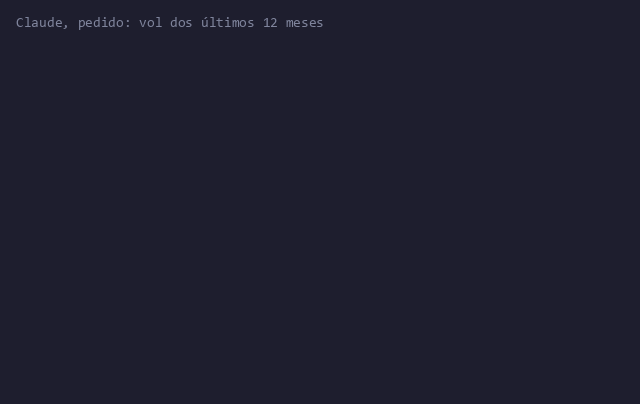
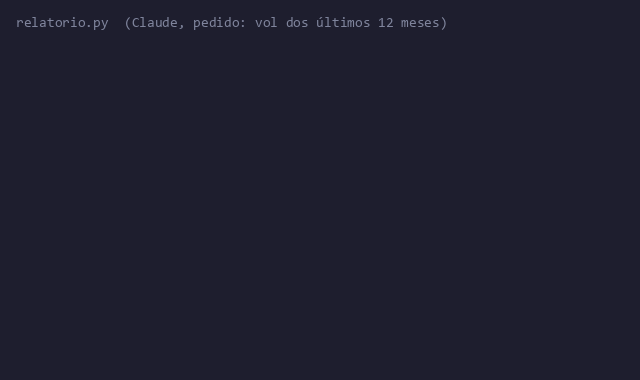

# copy-paste-check

**A mesma conta, escrita duas vezes, um dia dá dois números.**
copy-paste-check acha funções e fórmulas duplicadas em Python no momento em que o agente (Claude Code) escreve o arquivo, e de novo na revisão do PR.

Princípio: **o máximo determinístico, LLM só para o que não dá para decidir com regra.** O caminho rápido (hook e CLI) não chama nenhum modelo e não imprime nada quando não encontra duplicata. Isso mantém o custo de tokens perto de zero.

## Exemplo: a volatilidade do fundo

[`examples/vol/`](examples/vol) já tem a conta, escrita e validada uma vez:

```python
# shared/risco.py
def vol_anualizada(retornos, dias_uteis=252):
    validos = retornos.dropna()
    if len(validos) < 2:
        return float("nan")
    return float(validos.std(ddof=1) * np.sqrt(dias_uteis))
```

**Pedido novo:** "Claude, põe a vol dos últimos 12 meses no resumo."

**Sem copy-paste-check:** o Claude escreveu a própria `volatilidade`, com outros nomes e a mesma conta.



*Duas vols no repo. No dia em que alguém trocar o `ddof` de uma, o relatório e o painel discordam.*

**Com copy-paste-check:** o hook nega a escrita antes de o arquivo existir, e diz onde está a original:


```
cpcheck: já existe função equivalente no repo:
- `volatilidade` (nova) ≈ `vol_anualizada` em shared/risco.py:4 [struct]
Importe e use a existente em vez de recriar.
```

O Claude tentou de novo e importou a existente:



*Uma vol só. Custo da checagem: zero tokens.*

Os GIFs são gerados por [`media/demo.py`](media/demo.py): ele passa as duas versões de `relatorio.py` pelo hook de verdade, confere o veredito e desenha o texto que o hook devolveu.

## Como detecta

**Padrão:** `exact`, `struct` e `near` (só biblioteca padrão). `formula` é opcional: ligue com `formula = true` no `.cpcheck.toml` (exige `pip install ".[formula]"`). `near = false` desliga o `near`. Trocar essas opções recria o índice sozinho.

Cada função vira um conjunto de impressões digitais, calculadas a partir da AST (não de regex):

| Tipo | Técnica | Pega |
|---|---|---|
| `exact` | hash do corpo (ignora nome, docstring e comentários) | cópia idêntica |
| `struct` | hash da AST com variáveis locais renomeadas (`v0`, `v1`…) e literais trocados pelo tipo | cópia com nomes trocados. Mesma forma com **valores diferentes** (colunas, janelas, 252 × 365) sai como `struct~`: só avisa, é candidata a parametrizar |
| `formula` | toda expressão aritmética da função (não só o `return`), simplificada com sympy e invariante a nomes e ordem de variáveis | `(a - b) / b` = `a / b - 1`; `log(a) - log(b)` = `log(a / b)`; `df["close"] / df["close"].shift() - 1` = `precos.close.pct_change()` |
| `near` | MinHash+LSH acha candidatos; a nota é o Jaccard dos shingles ponderado por raridade no repo (boilerplate pesa pouco) | cópia com algumas linhas alteradas (Jaccard ponderado por raridade ≥ 0,75) |

O índice fica em SQLite (`.cpcheck/index.db` na raiz do repo) e é **incremental**: só reprocessa arquivos cujo tamanho ou data mudou.

Medido num repositório real (~1.050 arquivos Python, ~6.700 funções): primeiro scan em ~15 s, scans seguintes em ~0,1 s e hook em ~0,15 s. Lá ele achou, entre outras, a volatilidade anualizada (`std * √252`) repetida em 3 arquivos, o z-score em 2 e pesos `x / sum(x)` em 2.

Para as fórmulas não virarem ruído, cada operação, função conhecida ou constante não trivial soma peso, e só entram expressões com peso suficiente. Somas simples de variáveis (`a + b + c`) e arquivos de teste ficam de fora.

## Instalação

```bash
uv pip install -e ".[formula]"   # sem [formula] a camada de fórmulas fica desligada
```

## Uso

```bash
cpcheck scan                         # cria/atualiza o índice
cpcheck check shared/calc.py         # checa um arquivo contra o resto do repo
cpcheck diff --base origin/main      # só o que mudou no PR
cpcheck diff --base origin/main --markdown   # saída pronta para comentário de PR
cpcheck ask "lista de dias úteis entre datas"   # busca prévia em linguagem natural (Haiku, só leitura)
cpcheck bench gabarito.toml          # mede o review contra um gabarito do seu repositório
```

`--fail-on strong|any|none` controla o exit code (padrão: `strong`, ou seja, falha só em `exact`/`struct`).

`cpcheck review --base origin/main` é a passada completa de PR (working tree vs merge-base):

1. **Execução** (sem LLM): funções de conta puras (só `np`/`pd`/`math`) rodam num subprocesso isolado com o Python do projeto em entradas fixas; mesmo resultado = mesma conta (`execucao`), até 5% (`execucao~`, ex. `ddof`) é pista e vai ao Haiku como candidata. Se a etapa não rodar (Python do projeto sem numpy/pandas, timeout), avisa no stderr. Em worktree usa a `.venv` do checkout principal.
2. **Candidatas locais**: pares do índice + busca por vocabulário (FTS5/BM25: nome, docstring, o que a função usa, constantes como 252). Vocabulário só para função **nova** fora de teste; função alterada só vai adiante se o índice achar par.
   A busca só casa palavra igual, então antes dela uma chamada curta ao Haiku (~2,5 mil tokens) pede termos de busca para cada função nova: o nome técnico em inglês e português e siglas. É o que liga `_multiplo_do_capital` a `moic`. `--no-expand` pula.
3. **Uma chamada de julgamento ao Haiku, sem ferramentas**, com cada função e suas candidatas (12 linhas cada, sempre com o final da função); resposta que não aponta uma candidata mostrada é descartada. Num repositório real (7 funções novas): ~14 mil tokens, ~12 s. Pensamento limitado por `CPCHECK_THINKING` (padrão 2048). Rodar de novo sem mudar o código não gasta tokens (resposta guardada no índice local; `--no-cache` pergunta de novo).

### Hook do Claude Code

Veja [`examples/claude-settings.json`](examples/claude-settings.json). O mesmo comando atende dois eventos:

- **PreToolUse** (Write/Edit/MultiEdit em `.py`): **bloqueia** só quando há evidência forte (`exact`/`struct`) e diz qual função reutilizar.
- **PostToolUse**: **avisa** sem bloquear sobre `struct~`, `formula` e `near`.

Renomear uma função não bloqueia (a versão antiga do próprio arquivo não conta). Para **mover**, apague a original antes de escrever a nova.

Rode `cpcheck scan` uma vez ao instalar: o primeiro scan pode passar do timeout do hook (se for interrompido, o próximo continua de onde parou). A pasta `.cpcheck/` se ignora sozinha no git.

Só são checadas funções **novas ou alteradas** pela edição. `CPCHECK_MODE=warn` desliga o bloqueio.

Duplicação intencional (ex.: templates que precisam ser autocontidos): marque a `def` com `# cpcheck: ignore` na mesma linha ou na anterior, ou declare a regra no `.cpcheck.toml`.

Testado em sessão real do Claude Code (`claude -p`): o bloqueio impede a escrita e o agente responde que "`wavg` duplica `media_ponderada` em `shared/calc.py:2`"; o aviso de fórmula chega como contexto depois da escrita. Cada caso custou 2 turnos.

### Configuração

`.cpcheck.toml` na raiz (ou `[tool.cpcheck]` no `pyproject.toml`). Veja [`examples/cpcheck.toml`](examples/cpcheck.toml).

### Skill para agentes

[`skills/copy-paste-check/SKILL.md`](skills/copy-paste-check/SKILL.md) instrui o agente a procurar antes de criar e a decidir o que fazer com uma duplicata. É a parte "LLM" — ela só interpreta o que o CLI já provou.

## Roadmap

Ver [`ROADMAP.md`](ROADMAP.md).

## Licença

[MIT](LICENSE)
